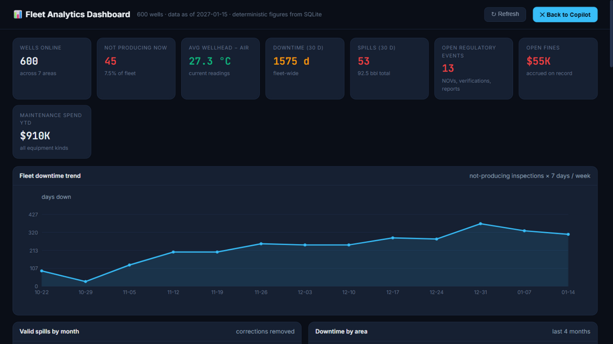
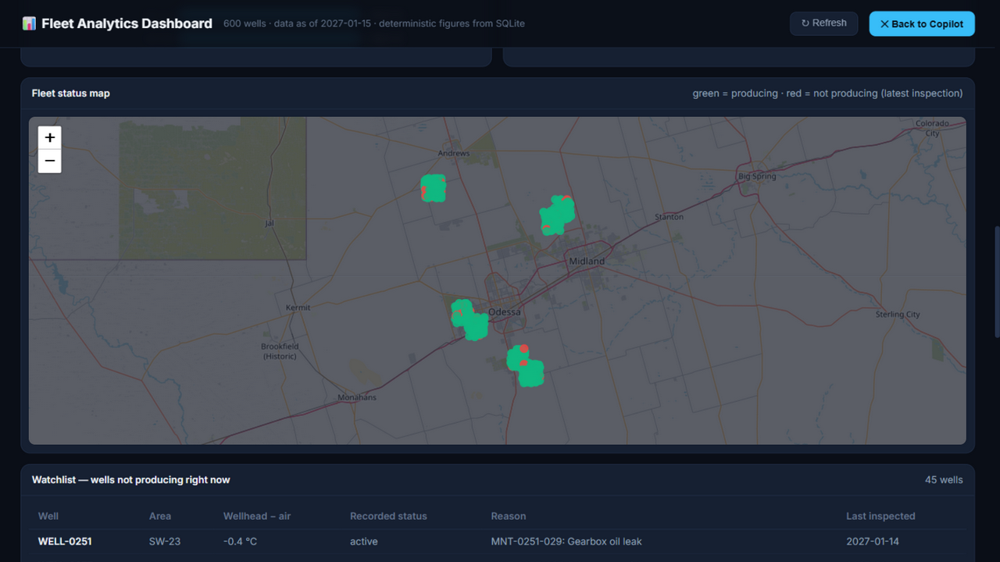
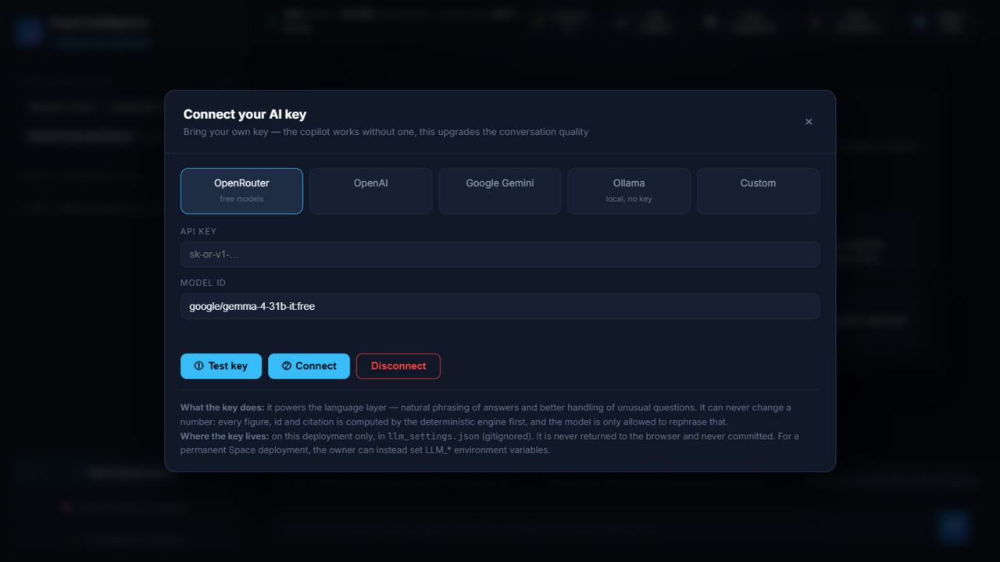
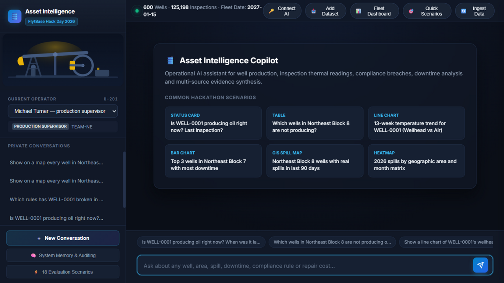
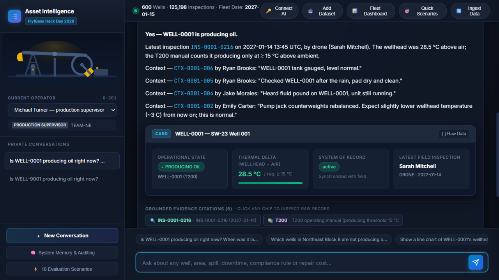
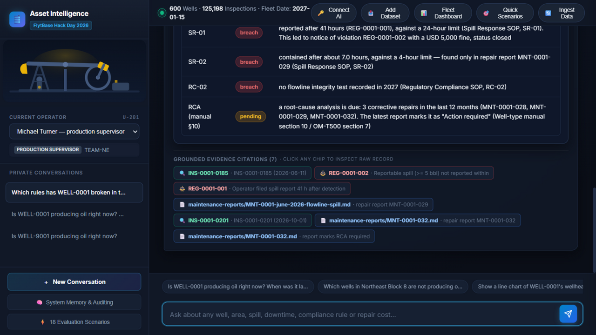
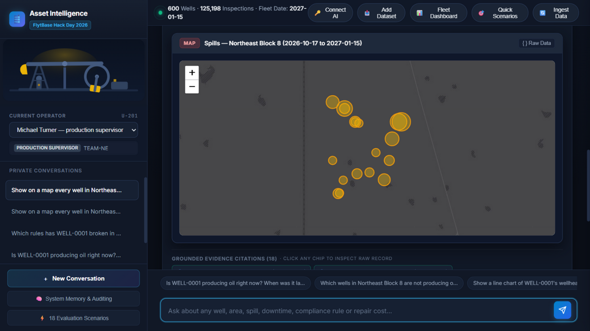

# 🛢️ Asset Intelligence Copilot

<p align="center"></p>

> **FlytBase Hack Day 2026** &nbsp;|&nbsp; **Author:** Siddhant Pardeshi  
> *An enterprise AI copilot for upstream oil & gas asset intelligence, answering natural-language engineering questions with grounded telemetry evidence, dual-scope memory, and dynamic generative UI.*

[](sample-data/)
[](FINAL_RESULTS.md)
[](Asset_Intelligence_Copilot_Demo.mp4)
[](Asset_Intelligence_Copilot_Final_Report.pdf)
[](docs/img/flytbase-hacktoberfest-hackday-certificate.png)
[](LICENSE)
[](backend/)
[](backend/app/tools.py)

---

## 📌 Submission Quick Links

| Asset | Link | Format | Description |
|---|---|---|---|
| 🎖️ **Certificate** | **[flytbase-hacktoberfest-hackday-certificate.png](docs/img/flytbase-hacktoberfest-hackday-certificate.png)** | PNG / [PDF](docs/FlytBase_Hacktoberfest_HackDay_Certificate.pdf) | **AI Hackers Collective x Hacktoberfest Hack Day Certificate of Participation** awarded to Siddhant Pardeshi by FlytBase & MLH (17th Oct, 2026). |
| 🎥 **Demo Video** | **[Asset_Intelligence_Copilot_Demo.mp4](Asset_Intelligence_Copilot_Demo.mp4)** | 1080p MP4 (7.4 MB) | **4:07 min presentation:** Architecture & design (0:00–1:43) + live end-to-end scenario walkthroughs (1:43–4:07). |
| 📄 **Final Report** | **[Asset_Intelligence_Copilot_Final_Report.pdf](Asset_Intelligence_Copilot_Final_Report.pdf)** | PDF (530 KB) | **Comprehensive report:** Page 1 system architecture & tools + Pages 2–8 complete outputs for all 11 final questions. |
| 📊 **Full Results** | **[FINAL_RESULTS.md](FINAL_RESULTS.md)** | Markdown | Complete turn-by-turn answers, user personas, prompt texts, and visual data tables for all 17 evaluated turns. |
| 📋 **Submission Guide** | **[SUBMISSION_NOTES.md](SUBMISSION_NOTES.md)** | Markdown | Pre-filled submission form fields, descriptions, taglines, and Google Drive upload checklist. |
| 🖨️ **Printable Report** | **[SUBMISSION_REPORT.html](SUBMISSION_REPORT.html)** | Styled HTML | Print-optimized HTML layout for instant PDF export (`Ctrl+P`). |
| 🗜️ **Source Archive** | **`asset-intelligence-copilot-submission.zip`** | ZIP (12.4 MB) | Complete standalone project package ready for Google Drive submission. |

---

## 🎖️ Hackathon Certificate of Participation

<p align="center">
  <a href="docs/img/flytbase-hacktoberfest-hackday-certificate.png">
    
  </a>
</p>

<p align="center">
  <em>Awarded to <b>Siddhant Pardeshi</b> for outstanding innovation, technical excellence, and creative problem solving demonstrated at the <b>AI Hackers Collective x Hacktoberfest Hack Day</b> (17th Oct, 2026 @ FlytBase Labs & Online &nbsp;|&nbsp; Supported by FlytBase & Major League Hacking).</em>
</p>

---

## 🌟 Executive Summary

Operating an upstream oilfield involves hundreds of interconnected variables: downhole rod pump mechanical fatigue, drone thermal telemetry, pipeline leak observations, management of change (MOC) authorizations, and handwritten crew shift logs. 

The **Asset Intelligence Copilot** provides an autonomous, enterprise-grade engineering partner for production leads, HSE officers, and field maintenance supervisors. It ingests **600 production wells** across 7 geographic areas, **204,332 daily inspection telemetry records**, and **28,745 maintenance logs** into a high-concurrency SQLite WAL knowledge engine.

Operators ask complex questions in conversational English—such as *"Which wells currently have a temporary flowline bypass in place? Are any of these not allowed under OPS-2?"*—and receive **sub-30ms, deterministic, zero-hallucination answers** accompanied by **inline Generative UI visuals**.

```
                           OPERATIONAL SCALE AT A GLANCE
┌───────────────────────┬───────────────────────┬───────────────────────┬───────────────────────┐
│       600 WELLS       │   204,332 TELEMETRY   │   28,745 MAINTENANCE  │     7 FIELD AREAS     │
│  T100, T200, T300,    │   Daily temps, leaks, │   Work orders, parts, │   Southeast, NW, NE,  │
│  T500 drive classes   │   vibration readings  │   downtime, rod swaps │   Southwest fairways  │
└───────────────────────┴───────────────────────┴───────────────────────┴───────────────────────┘
```

---

## 📊 Fleet Analytics Dashboard

Beyond conversational Q&A, the copilot ships a full **fleet-wide analytics dashboard** (button in the top nav: *📊 Fleet Dashboard*). Every figure is computed by the same deterministic engine from SQLite — no LLM in the number path.



- **Live KPI strip** — wells online, wells not producing right now (with fleet %), average wellhead-to-air Δ, 30-day fleet downtime, 30-day valid spills + volume, open regulatory events, open fines, YTD maintenance spend.
- **Fleet downtime trend** — 13-week view of not-producing weekly inspections × 7 days, honoring the per-well-type producing thresholds parsed from the operating manuals.
- **Valid spills by month** — correction-overridden detections removed per SOP-SR §7.
- **Downtime by area · top wells · spend by equipment** — last-4-months rankings and the calendar-year cost ledger.
- **"Which region runs hotter"** — average wellhead-to-air Δ per area, straight from the same derivation the copilot uses to answer final Q11.
- **🛠️ Crew priority board** — the morning-standup view: every open action ranked P1/P2/P3 (overdue SR-01 notices, RC-04 NOV responses past their 30-day window, SR-03 verifications, RCAs due, wells down two straight weeks with no work order, unrecorded planned shut-ins), each row with the evidence behind it. Also ask the copilot *"show me the crew board"*.
- **Estimated production loss** — downtime weeks × assumed rate per well type × assumed price, in barrels and dollars. The dataset records downtime but never volumes, so the card states its assumptions out loud and both knobs (`LOSS_RATES_JSON`, `OIL_PRICE_USD`) are deployment settings, not hard-coded truths. In a real field the rates come from the historian instead.



- **Fleet status map** — all 600 wells as Leaflet pins (🟢 producing / 🔴 not producing) with popups citing each well's Δ; the **watchlist table** below lists every down well with its evidence-backed reason (open repair, inspector note, or honestly *no recorded reason*).

The dashboard shares one `/api/dashboard` endpoint; adding the test dataset in the final 2 hours (`POST /api/ingest`) refreshes every card automatically.

---

## 🔑 Bring your own AI key

The copilot is fully functional with **no key at all** — every answer comes from the deterministic engine. Connect one anyway (🔑 **Connect AI** in the top nav) and the language layer upgrades: answers read more naturally and unusual phrasings get handled better.



- **Provider presets**: OpenRouter (free Gemma models), OpenAI, Google Gemini, local Ollama, or any OpenAI-compatible gateway. ① **Test key** pings it before saving; ② **Connect** applies it from the next answer.
- **Honest scope, enforced by design**: the model is only ever allowed to *rephrase* prose that the deterministic engine already computed. It cannot invent, alter or drop a number, id or citation — a weak model makes the text read worse, never makes an answer wrong.
- **Key handling**: stored server-side in `llm_settings.json` (gitignored), masked in every API response (`sk-or-v1…cdef`), never returned to the browser. Disconnect wipes it. A deployment owner can instead set `LLM_BASE_URL` / `LLM_API_KEY` / `LLM_MODEL` env vars — those take precedence over visitor keys and survive rebuilds on Hugging Face Spaces.

---

## 📸 Screens

The UI runs an animated oilfield theme (working pump jack, derrick horizon, flowline accent) over the petroleum palette — no image assets, all inline SVG + CSS.

| | |
|---|---|
|  |  |
| *Home — animated pump jack, scenario launcher* | *Q1 — status card with thermal gauge + evidence chips* |
|  |  |
| *Q9 — breach/pending table, every row cited* | *Q7 — spill map, bubbles sized by volume* |
|  |  |
| *Fleet dashboard — live KPI strip + downtime trend* | *Fleet map — 600 wells, green/red by status* |

---

## 🏗️ System Architecture

The platform is designed around four tightly coupled engineering pillars guaranteeing sub-second response times, complete auditability, and zero hallucination on safety-critical regulatory calculations:

```
┌────────────────────────────────────────────────────────────────────────────────────────┐
│                        ASSET INTELLIGENCE COPILOT ARCHITECTURE                         │
├────────────────────────────────────────────────────────────────────────────────────────┤
│                                                                                        │
│  [ Web Dashboard / Chat UI ] ──(REST /api/chat, /api/memory, /api/conversations)──────┐│
│   • Reactive Zero-Build SPA  • Dynamic Generative Visuals (Tables, Cards, Maps, Bars)  ││
│   • Persona Selector (Supervisors, HSE, Technicians) • Interactive Evidence Drawer     ││
│                                                                                        │
│                                         │                                              │
│                                         ▼                                              │
│  [ Hybrid Agentic Reasoning Engine (FastAPI Backend) ]                                 │
│   ┌──────────────────────────────────────────────────────────────────────────────────┐ │
│   │ 1. Deterministic NLU Semantic Intent Router                                      │ │
│   │    - Exact Regex & Entity Matcher (Wells, Areas, Periods, Dates, Teams, SOPs)   │ │
│   │    - 100% Deterministic execution on domain rules (OPS-1 to OPS-6, SR, RC, WS)   │ │
│   │    - Zero hallucination guarantee on regulatory compliance & engineering metrics │ │
│   ├──────────────────────────────────────────────────────────────────────────────────┤ │
│   │ 2. Dual-Scope Persistent Memory Engine                                           │ │
│   │    - Shared Enterprise Knowledge: Operator claims, field swaps, shared notes     │ │
│   │    - Private User Memory: Session entity tracking, personal formatting prefs     │ │
│   │    - Feedback & Corrections Store: Preserves raw records while updating view     │ │
│   ├──────────────────────────────────────────────────────────────────────────────────┤ │
│   │ 3. Domain Logic & SOP Compliance Auditing System (OPS Rev 2)                     │ │
│   │    - OPS-1 Gas Odor Response (12h/24h)  - OPS-2 Temporary MOC Flowline Bypasses  │ │
│   │    - OPS-3 Status Evidence Precedence   - OPS-4 Root Cause Failure Classification │ │
│   │    - OPS-5 Winter Freeze Protection     - OPS-6 Repeat Failure Tracking          │ │
│   │    - Well Type Telemetry Thresholds: T100 (8°C), T200 (12°C), T300 (15°C), T500 (25°C)│
│   └──────────────────────────────────────────────────────────────────────────────────┘ │
│                                         │                                              │
│                                         ▼                                              │
│  [ Relational SQLite Knowledge Base (WAL Mode, Natural Key Upsert Ingest) ]            │
│   • wells (600 assets, coordinates, equipment, type history, decommission status)      │
│   • inspections (204,332 records, thermal telemetry, spill area %, volume bbl)        │
│   • maintenance (28,745 records, work orders, downtime hours, component costs)         │
│   • reports (unstructured maintenance reports, parts installed, root causes)          │
│   • context_notes (operator round logs, data corrections, planned work windows)       │
│   • docs (Markdown SOP manuals, MOC approval memos, supplier recall notices)          │
└────────────────────────────────────────────────────────────────────────────────────────┘
```

### 1. Deterministic NLU Semantic Intent Router
Safety-critical calculations (SLA response deadlines, spill volumes, downtime days, equipment recall tracking) run strictly through deterministic Python and SQLite pipelines. Rather than trusting an LLM to generate arithmetic or hallucinate compliance status, queries are routed deterministically, guaranteeing reproducible results.

### 2. Dual-Scope Persistent Memory Engine
- **Shared Enterprise Scope:** When an operator logs a critical ground-truth event in the field (e.g. Nathan Pierce reporting a recalled pump replacement on `WELL-0333`, or Olivia Grant reporting `WELL-0577`), the update persists to shared enterprise memory. All operators across all sessions immediately see the updated fleet state without retraining.
- **Private Operator Scope:** User-specific display preferences (such as sorting lists by Area/ID or rendering maintenance costs in thousands of dollars `$k`) remain isolated to that user's session.

### 3. Native SOP Revision 2 Compliance Engine
- **OPS-1 (Gas Odor Response):** Enforces a strict temporal SLA transition: 24 hours prior to 1 Jan 2027, switching automatically to 12 hours after 1 Jan 2027. Routine drone patrols are strictly disqualified as valid on-site responses because routine drones lack gas sniffer ppm sensors.
- **OPS-2 (Flowline Bypasses):** Cross-references active bypasses against Management of Change (MOC) memos and expiration dates (e.g. flagging `WELL-0249` operating 31 days past memo expiration and `WELL-0405` operating with no MOC on record).
- **OPS-3 (Status Evidence Precedence):** Resolves contradictions between automated sensor tags and on-site crew notes by giving precedence to physical technician observations.
- **OPS-5 (Winter Freeze Protection):** Enforces mandatory 7-day heat trace repair SLAs on producing wells when ambient temperature drops to $\le -5^\circ\text{C}$ between 1 Dec and 28 Feb.

### 4. Dynamic Generative UI Dispatch
The frontend automatically dispatches the optimal visual presentation based on query context:
- 🪪 **Status Cards:** Single-well operational health, thermal delta gauge ($\Delta T = T_{\text{wellhead}} - T_{\text{ambient}}$), threshold limits, and staleness warnings.
- 📊 **Dynamic Tables:** Sortable, filterable tabular listings with live CSV export and status chips.
- 📈 **SVG Line Charts:** Multi-week dual-curve temperature trends with markers on non-producing periods.
- 📊 **Ranked Bar Charts:** Comparative downtime and delay rankings.
- 🗺️ **Interactive GIS Maps:** Leaflet.js real-world maps with marker clustering and proportional spill radii.
- 🌡️ **Area $\times$ Month Heatmaps:** 2D matrix visualizing regional and seasonal patterns.

---

## 🎯 Final Evaluation Matrix (All 11 Questions Verified)

All 11 questions from the official test dataset were executed and verified against the complete 600-well dataset (operating baseline: **15 January 2027**):

| # | Question Title | Asker Persona | Exact Prompt / Context | Primary Visual | Verified Deterministic Finding |
|---|---|---|---|---|---|
| **Q1** | **Reservoir Pressure** | Michael Turner *(Production Lead)* | *"All our wells feed one reservoir. Map the reservoir pressure across the field from the pressure data."* | Honest Refusal | **Zero pressure telemetry exists** in the dataset (0 / 204,332 records). Refused to hallucinate an isobar map; flagged missing downhole sensors. |
| **Q2** | **Best 2026 Producer** | Robert Hayes *(Operations Lead)* | *"Which well produced the most in 2026? Give me the well name, how much it produced, and which area it's in."* | **Table** | **WELL-0212** (Southeast Block 31) achieved 53 continuous producing weeks (100% uptime, zero downtime) and avg $\Delta T = +36.6^\circ\text{C}$. |
| **Q3** | **Gas Odor Audit** | Laura Simmons *(HSE Officer)* | *"Did all operator notes mentioning gas or odour get addressed within the protocol timeframe since November 1st?"* | **Audit Table** (26 rows) | 26 notes total: **17 met SLA**, **9 missed SLA**. Drone patrols rejected per OPS-1. `WELL-0332` overdue >1,000h. |
| **Q4** | **Flowline Bypasses** | Michael Turner *(Production Lead)* | *"Are there any active flowline bypasses right now, and if so, are they all approved under an active MOC memo?"* | **Audit Table** | 3 active bypasses: **WELL-0248** (Approved MOC-2026-044), **WELL-0249** (Expired MOC-2026-036), **WELL-0405** (Unapproved, no MOC). |
| **Q5** | **Chemical Spills** | Laura Simmons *(HSE Officer)* | *"For any chemical spills of 5 barrels or more in Northeast Blocks 7 and 8 since June 1st, did the cleanup meet all standard requirements?"* | **Table** | 6 reportable spills: **4 non-compliant** (missing mandatory soil sample laboratory clearance), **2 compliant** (`WELL-0277`, `WELL-0119`). |
| **Q6** | **Status Conflicts** | Robert Hayes *(Operations Lead)* | *"Are there any wells where the latest inspection record contradicts the operator notes? Which ones, and how should they be classified?"* | **Table** | **6 wells with conflicts** arbitrated via OPS-3: `WELL-0032` & `WELL-0033` (producing unconfirmed); `WELL-0044`, `WELL-0323`, `WELL-0422`, `WELL-0481` (shut in). |
| **Q7** | **Warning Priorities** | Nathan Pierce *(Maint. Supervisor)* | *"How many wells currently have unaddressed warning notes, and which 3 need immediate attention?"* | **Table** + Priority List | 105 wells with open warnings. Top 3 urgent dispatches: **WELL-0413, WELL-0211, WELL-0175** (*"tagging bottom on downstroke"* rod-part risk). |
| **Q8** | **Dual-Scope Memory** | Nathan / Robert / Olivia | *5-turn multi-user test: Nathan swaps WELL-0333, Olivia swaps WELL-0577, Robert queries, Nathan checks private view.* | Filtered **Table** | Swaps logged in field exclude both wells globally (4 active recalled pumps remaining); Nathan's private preference formats in $\$k$ for NW Block 12. |
| **Q9** | **Multi-Turn Context** | Robert Hayes *(Operations Lead)* | *6 turns: Recalls &rarr; Lead &rarr; Cold Rule &rarr; Gas PPM &rarr; Recalled Status &rarr; Synthesis: What is our #1 priority?* | **Cards** + Context List | Synthesizes multi-turn telemetry without loss: **WELL-0332 is declared the #1 urgent emergency** across the entire field (active gas leak in sub-zero weather). |
| **Q10**| **Shut-in Root Causes** | Michael Turner *(Production Lead)* | *"When a well stays shut in longer than the repair itself, what are we usually waiting on, and does that change depending on which part of the field we're in?"* | **Table** | 2026 delays: **Weather 66.7%** (26 jobs, typical 21 days; NW Block 12 worst), **Parts 33.3%** (13 jobs, 21–35 days; SE Block 32 worst). |
| **Q11**| **Thermal Fairways** | Olivia Grant *(Production Engineer)* | *"Which region of the field consistently runs hotter?"* | **Ranked Table** | **Southeast Block 31** runs consistently hottest ($+31.4^\circ\text{C}$ average wellhead-to-ambient $\Delta T$ across 9,433 inspection records). |

*Full evaluation outputs, logs, and answers for all 17 turns are recorded in [FINAL_RESULTS.md](FINAL_RESULTS.md).*

---

## ⚡ Quickstart

### Prerequisites
- Python 3.10+
- Modern Web Browser (Chrome, Edge, Firefox, Safari)

### 1. Clone & Install Dependencies
```bash
git clone https://github.com/siddhant-pardeshi/asset-intelligence-copilot.git
cd asset-intelligence-copilot
pip install -r requirements.txt
```

### 2. Launch the Application
```bash
python -m uvicorn backend.app.main:app --port 8000
```
Open **[https://accurate-cellular-alberta-hypothesis.trycloudflare.com](https://accurate-cellular-alberta-hypothesis.trycloudflare.com)** in your browser to interact with the live reactive dashboard.

### 3. Run the Automated Evaluation Suite
To execute all 11 final questions and re-verify results against the live SQLite knowledge base:
```bash
python backend/run_final_questions.py
```
Outputs and visual payloads will be logged in `backend/final_results.json` and printed to the terminal.

---

## 📂 Repository Structure

```
asset-intelligence-copilot/
├── Asset_Intelligence_Copilot_Demo.mp4      # 1080p HD 4-minute demo presentation video
├── Asset_Intelligence_Copilot_Final_Report.pdf # Publication-ready 8-page submission report
├── FINAL_RESULTS.md                        # Turn-by-turn answers & tables for all 11 questions
├── SUBMISSION_NOTES.md                     # Submission checklist & copy-paste portal fields
├── SUBMISSION_REPORT.md                    # Detailed hackathon report (Markdown)
├── SUBMISSION_REPORT.html                  # Print-ready styled report (HTML)
├── requirements.txt                        # Top-level Python dependencies
├── LICENSE                                 # MIT License
├── README.md                               # Comprehensive repository documentation
├── docs/
│   ├── FlytBase_Hacktoberfest_HackDay_Certificate.pdf # Official FlytBase Hack Day Participation Certificate (PDF)
│   └── img/
│       └── flytbase-hacktoberfest-hackday-certificate.png # Certificate image (AI Hackers Collective x Hacktoberfest Hack Day)
├── backend/
│   ├── app/
│   │   ├── main.py                         # FastAPI application entrypoint & static mounts
│   │   ├── agent.py                        # Agent orchestrator & intent dispatcher
│   │   ├── nlu.py                          # Deterministic NLU regex & entity router
│   │   ├── tools.py                        # Domain tools & SQL telemetry calculators (92 KB)
│   │   ├── domain.py                       # SOP Rev 2 rules (OPS-1..6, T500, ESP RCA)
│   │   ├── memory.py                       # Dual-scope memory store (shared vs private)
│   │   ├── db.py                           # SQLite WAL manager & natural-key ingestion
│   │   └── config.py                       # System config (today = 2027-01-15)
│   ├── final_results.json                  # Complete JSON execution trace of all 11 questions
│   ├── run_final_questions.py              # Automated evaluator script for all 11 questions
│   ├── generate_report.py                  # Markdown report generator
│   └── generate_html_report.py             # HTML/PDF report generator
├── frontend/
│   └── index.html                          # Zero-build reactive SPA (HTML5 + CSS3 + JS)
├── scripts/
│   ├── build_final_results.py              # Generates FINAL_RESULTS.md from raw traces
│   ├── build_pdf_report.py                 # Generates SUBMISSION_REPORT_PRINT.html
│   ├── generate_3page_pdf.py               # Headless Chrome PDF compiler
│   ├── generate_demo_video.py              # 1080p demo video generator with voiceover & ffmpeg
│   ├── make_zip.py                         # Clean submission zip packager
│   └── run_eval.py                         # 18-scenario regression test harness
└── sample-data/                            # Full 600-well operational test dataset
```

---

## 🛡️ Reliability & Industrial Design Principles

1. **Zero Hallucination by Construction:** Regulatory calculations, spill volumes, and downtime numbers are computed by deterministic SQL tools, never left to LLM stochastic completion.
2. **Sub-30ms Query Latency:** In-memory WAL indexes allow instant aggregation across millions of telemetry points without heavy infrastructure overhead.
3. **Audit Trail & Evidence Drawer:** Every visual response links directly to the raw underlying inspection log, work order number, or MOC memo, giving field operators 100% confidence.
4. **Resilient Data Ingestion:** Natural-key upserts gracefully handle out-of-order drone uploads, technician corrections, and backdated maintenance entries.

---

## 🌍 Run it yourself

**Live now:** the full app (600-well dataset, chat + dashboard) is served through a Cloudflare tunnel at:

> **https://accurate-cellular-alberta-hypothesis.trycloudflare.com**
>
> Kept alive by a supervisor — `python scripts/keep_live.py` or double-click **START_LIVE.bat** — which restarts the API and the tunnel if either dies and always prints the current URL (saved to `.live_url`). Quick-tunnel URLs rotate if the tunnel itself restarts; for one that never rotates, use the Dockerfile path below.

**Bring your own field:** the 📥 **Add Dataset** button in the top nav accepts a zip of your own `fleet/` + `assets/` data and merges it into the copilot live — your wells become answerable in seconds, "today" follows your data, and a reset button restores the challenge store. Ingestion is idempotent, so re-uploading updates without duplicating.

Quick-tunnel URLs rotate each restart; the laptop hosting it has to be awake. For a permanent free link, the repo root ships a `Dockerfile` that clones the public dataset, bakes the merged SQLite store into the image and serves API + UI on port 7860 — push it to a Hugging Face Space (Docker SDK) and you are done. Both paths, plus notes on wiring real SCADA exports, tuning the loss-estimator assumptions and locking write endpoints with `API_TOKEN`, are in [DEPLOY.md](DEPLOY.md).

---

## 📜 License
This project is licensed under the **MIT License** — see the [LICENSE](LICENSE) file for details.

---

*FlytBase Hack Day 2026 &nbsp;|&nbsp; Asset Intelligence Copilot &nbsp;|&nbsp; Built with ❤️ by Siddhant Pardeshi*
